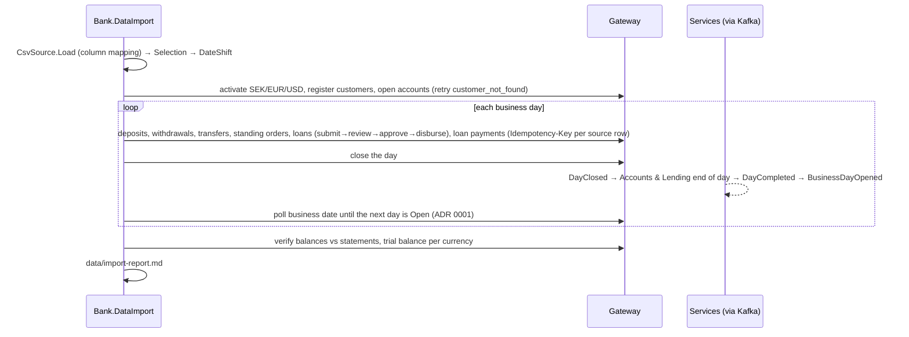

# Slices 7.3 to 7.5: The data import, reading, replay, report and verification

## Part 1. The big picture

A demo bank with no history cannot show arrears, penalties or a trial balance worth looking at. The design plan (section 7) fills it with about 100 customers and their real-looking history from a CC0 sample dataset. The import goes **through the gateway**, not into the databases, so every rule, event and journal entry runs exactly as in real operations. Time advances day by day, so end of day, penalties and classification happen naturally.

The hard parts:

- the replay must follow the bank's calendar and wait for each end of day across services;
- a re-run must not duplicate anything;
- the result must be **verifiable**: balances against statements, and a zero trial balance.

## Part 2. The building blocks and how they connect



- **`Logic/ImportLogic.cs`** (pure, tested first):
  - `Selection` picks the customers, with fixed minimums and a fixed seed;
  - `DateShift` keeps the last two years and moves the first kept day to StartDate;
  - `Amounts.ToSek` converts amounts to SEK;
  - `LoanTypes.Map` maps the dataset's loan type to a product;
  - `IdempotencyKeys.For` derives a key from each source row;
  - `StagePlanner.Equal` builds PURCHASE stages.
- **`Source/SourceData.cs`**: `CsvSource.Load` reads the six CSV files through a configurable column mapping, and handles quoted values. With no files, it stops with a download hint and never downloads anything.
- **`Importer.cs`**: the replay. It applies each command through the gateway and counts the result or records the skip reason, closes and polls each day, flags payment-amount mismatches, then verifies.
- **`Program.cs`**: command-line arguments, the report file, and an exit code that is 0 only when verification passed.
- **The fixture** (`tests/.../Fixture/*.csv`): 5 synthetic customers with `example.com` addresses. They cover a transfer, an external transfer, an overdraft (skipped), CAR and PURCHASE loans, a mortgage below the product minimum (skipped), a standing order and a loan payment.

## Part 3. Why it is designed this way

- **D1 on your delegation** (bank-data-import ADR 0001): poll the business date instead of consuming Kafka, and replay sequentially instead of in parallel.
- **Gaps:** the dataset's column names are unknown, so they are mapped in `appsettings.json` and must be checked against your export. Amounts or terms outside a product are skipped and reported, never clamped.
- **How the design changed (the first run against the real AppHost found three things):**
  - the import must use each service's own paths under the gateway prefix (`/api/accounts/accounts/...`), not `/api/accounts`;
  - reads must identify themselves too, or the gateway answers 401;
  - the full end-of-day cycle through Kafka works: a diagnostic run showed all four days closing in under a second each;
  - eventual consistency is normal, so the importer retries "not yet" answers (`customer_not_found`, `currency_not_active`, `repayment_account_invalid`, `date_in_future`) with the same idempotency key for up to a minute;
  - **a real bug in `Bank.Messaging.Kafka` (fixed in 0.6.1).** About one run in three, Accounts read nothing from `customers.events` for 4–5 minutes, and the report showed `account A1: 422 customer_not_found` four times. Kafka creates a topic asynchronously: `CreateTopicsAsync` returns before the broker's metadata shows the topic. A consumer that subscribes in that gap does not see the topic and looks again only at its next metadata refresh, which librdkafka does every 5 minutes by default. The topic initializer now waits until every topic has a leader for each partition, and the consumer refreshes its metadata every 10 seconds. All services moved to the 0.6.1 packages. A fresh production start would have had the same 5-minute blind spot, so the importer's retry was only covering up the bug, not fixing it.

Patterns: ETL with an idempotent load (replayable keys), event-driven time advance with polling, reconciliation as the last step.

## 4. What was tested

- **Unit** (18 tests): selection minimums and determinism, date shift (short and long history, leap year), conversion, mapping, idempotency keys, stage planning.
- **Integration** (1 test, about 40 seconds): the fixture is imported through the gateway of the real AppHost (six services, PostgreSQL, Kafka), and the report shows:
  - 5 customers and 5 accounts;
  - deposits, a transfer, an external transfer, CAR and PURCHASE loans and a standing order applied;
  - the overdraft and the out-of-range mortgage skipped with their codes;
  - **verification passed**.

```
bank-data-import: UnitTests 18, IntegrationTests 1 passed
```

## 5. Check your understanding

1. Why does the import go through the gateway instead of writing to the databases?
2. What makes a second run of the import safe?
3. Which two checks prove the import left the books consistent?
