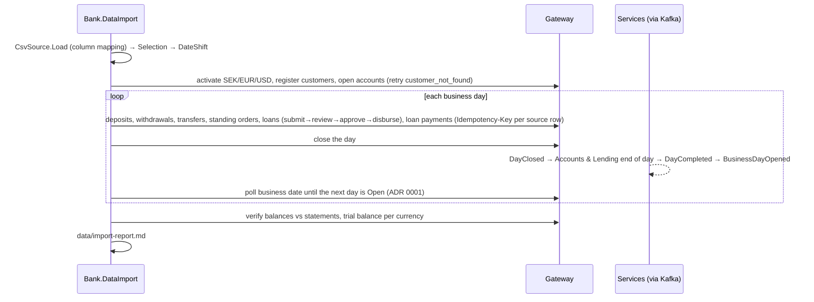

# Slices 7.3 to 7.5: The data import, reading, replay, report and verification

## Part 1. The big picture

A demo bank with no history cannot show arrears, penalties or a trial balance worth looking at. The design plan (section 7) fills it with about 100 customers and their real-looking history from a CC0 sample dataset. The import goes **through the gateway**, not into the databases, so every rule, event and journal entry runs exactly as in real operations. Time advances day by day, so end of day, penalties and classification happen naturally.

The hard parts:

- the replay must follow the bank's calendar and wait for each end of day across services;
- a retry must not duplicate anything, and a second run must not damage a bank that already holds the data;
- the result must be **verifiable**: balances against statements, and a zero trial balance.

## Part 2. The building blocks and how they connect



- **`Logic/ImportLogic.cs`** (pure, tested first):
  - `Selection` picks the customers, with fixed minimums and a fixed seed. The traits it counts (a loan, late payments, a standing order) come only from rows inside the two-year window, and the report says how many of each it reached against the target;
  - `DateShift` keeps the last two years and moves the first kept day to the bank's current business date;
  - `Amounts.ToSek` converts amounts to SEK;
  - `LoanTypes.Map` maps the dataset's loan type to a product by whole word ("Credit card" is not a car);
  - `AccountTypes.Map` and `Frequencies.Map` map only values they know, and return null otherwise, so the row is skipped and reported;
  - `IdempotencyKeys.For` derives a key from each source row;
  - `StagePlanner.Equal` builds PURCHASE stages, capped by the product's `MaxStages`, which the importer reads from `GET /api/lending/loan-products`.
- **`Source/SourceData.cs`**: `CsvSource.Load` reads the six CSV files through a configurable column mapping, and handles quoted values. With no files, it stops with a download hint and never downloads anything.
- **`Importer.cs`**: the replay. It applies each command through the gateway and counts the result or records the skip reason, closes and polls each day, flags payment-amount mismatches, then verifies.
- **`Program.cs`**: command-line arguments, the report file (also a partial one when the import stops), and an exit code that is 0 only when verification passed.
- **Fresh bank only.** Customers are registered with national id `IMP-<source id>`. A 409 on the first one means an earlier import ran: the tool stops before writing anything. No customer can be looked up again by its source id, so a second run could only replay empty days and age the existing loans into default. That is why it never "resumes". With no account opened it stops before closing a day, and verification fails when it checked no account.
- **The fixture** (`tests/.../Fixture/*.csv`): 5 synthetic customers with `example.com` addresses. They cover a transfer, an external transfer, an overdraft (skipped), CAR and PURCHASE loans, a mortgage below the product minimum (skipped), a standing order and a loan payment.

## Part 3. Why it is designed this way

- **D1 on your delegation** (bank-data-import ADR 0001): poll the business date instead of consuming Kafka, and replay sequentially instead of in parallel.
- **Gaps:** the dataset's column names are unknown, so they are mapped in `appsettings.json` and must be checked against your export. Amounts or terms outside a product are skipped and reported, never clamped.
- **How the design changed (the first run against the real AppHost found three things):**
  - the import must use each service's own paths under the gateway prefix (`/api/accounts/accounts/...`), not `/api/accounts`;
  - reads must identify themselves too, or the gateway answers 401;
  - the full end-of-day cycle through Kafka works: a diagnostic run showed all four days closing in under a second each;
  - eventual consistency is normal, so the importer retries "not yet" answers (`customer_not_found`, `currency_not_active`, `repayment_account_invalid`, `date_in_future`) with the same idempotency key for up to a minute;
  - **a real bug in `Bank.Messaging.Kafka` (fixed in 0.6.1).** About one run in three, Accounts read nothing from `customers.events` for 4–5 minutes, and the report showed `account A1: 422 customer_not_found` four times. Kafka creates a topic asynchronously: `CreateTopicsAsync` returns before the broker's metadata shows the topic. A consumer that subscribes in that gap does not see the topic and looks again only at its next metadata refresh, which librdkafka does every 5 minutes by default. The topic initializer now waits until every topic has a leader for each partition, and the consumer refreshes its metadata every 10 seconds. All services moved to the 0.6.1 packages. A fresh production start would have had the same 5-minute blind spot, so the importer's retry was only covering up the bug, not fixing it.

- **The banking review found five more things, all fixed:**
  - a second run (or `--force`) registered nobody but still closed every day, so the loans already in the bank went into default, and verification still said "passed". It is now refused, as described above;
  - the selection minimums counted loans from before the two-year cut-off, so the bank could end up with far fewer loans than the target. They now count only rows inside the window, and the report shows any shortfall;
  - `Contains("car")` matched "credit card";
  - the PURCHASE stage cap was hard-coded as 4 instead of read from the product;
  - unknown frequencies became Monthly and unknown account types became Current, which are business rules nobody decided. They are now skipped and reported.

Patterns: ETL with an idempotent load (replayable keys), event-driven time advance with polling, reconciliation as the last step.

## 4. What was tested

- **Unit** (33 tests): selection minimums and determinism, date shift (short and long history, leap year), conversion, loan type, account type and frequency mapping, idempotency keys, stage planning.
- **Integration** (1 test, about 40 seconds): the fixture is imported through the gateway of the real AppHost (six services, PostgreSQL, Kafka), and the report shows:
  - 5 customers and 5 accounts;
  - deposits, a transfer, an external transfer, CAR and PURCHASE loans and a standing order applied;
  - the overdraft and the out-of-range mortgage skipped with their codes;
  - **verification passed**;
  - the selection shortfall is reported (3 loan customers against a target of 30);
  - a second run is refused at the first customer, and the business date does not move.

```
bank-data-import: UnitTests 33, IntegrationTests 1 passed
```

## 5. What to watch later

- **The trial balance check proves little on its own:** every journal entry is balanced by construction. A stronger reconciliation compares the customer-deposits GL balance with the sum of account balances, and loans receivable with Lending's outstanding principal (stage 8 end-to-end scenarios check the books more directly).
- **The payment mismatch check** compares a payment with the first unpaid item's full amount, so a partly paid item always shows as a mismatch. It is a report line only.
- **The real export** must be checked for column names, and for whether a transfer appears once or on both sides.
- **Standing orders that started before the cut-off** but are still active are skipped and reported, not started at the first kept day (a business decision for you).

## 6. Check your understanding

1. Why does the import go through the gateway instead of writing to the databases?
2. Why does a second run stop at the first customer instead of trying to resume?
3. Which two checks prove the import left the books consistent?
