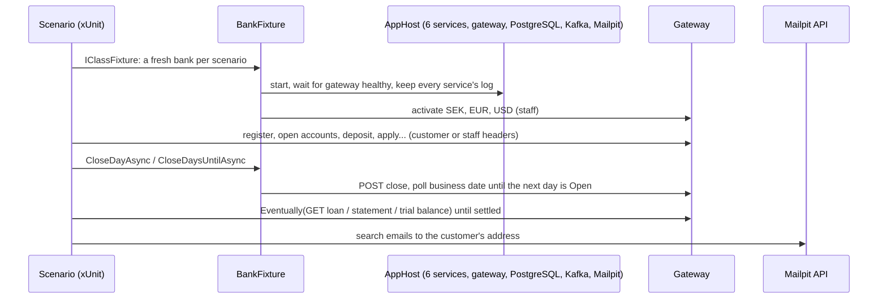

# Slice 8.1: End-to-end scenarios

## Part 1. The big picture

Every service already has its own tests. Unit tests prove the pure logic. Service integration tests prove one service with a real database and an in-memory broker. Neither can prove that **the services agree with each other**: that a transfer Accounts made shows up in the ledger the way Ledger booked it, or that a missed installment in Lending ends with an email from Customers. The design plan (section 8) puts a few end-to-end scenarios at the top of the test pyramid for exactly that.

What makes them hard:

- **Time.** A scenario covers months of business days. A day only advances when Operations closes it and every participant (Accounts, Lending) has finished its end of day.
- **Eventual consistency.** Collections, allocations, journal entries and emails travel through Kafka. They arrive a moment after the call or the day that caused them. Even each service's own business date follows Operations a moment later.
- **Isolation.** The business date is global, so two scenarios in one bank would push each other's days forward.

## Part 2. The building blocks and how they connect



### `tests/Bank.EndToEndTests/Support/BankFixture.cs`

- **`BankFixture`** starts the real AppHost (`DistributedApplicationTestingBuilder`) once per test class, with random ports and no dashboard. It waits for the gateway to be healthy and activates the three currencies, as an operator would. It also streams every service's console log into `e2e-logs/<run>/<service>.log`, so a failure can be read afterwards. The CI workflow uploads that folder.
- **`Caller`** is one identity's view of the gateway. `Staff` sends `X-Performed-By`; `Customer(id)` sends `X-Customer-Id`, so the services apply their ownership checks. It offers three ways to call:
  - `GetAsync` and `PostAsync`, which must succeed; a money move gets a fresh `Idempotency-Key`;
  - `PostWhenKnownAsync`, which retries the codes that mean "the other service has not heard yet", such as `customer_not_found` and `repayment_account_invalid`.
- **`CloseDayAsync`** closes the day and polls `GET /business-days/current` until a later date is Open. **`CloseDaysUntilAsync(date)`** repeats that until the date.
- **`Eventually.Async` / `Eventually.Value`** poll a read until a condition holds, and fail with a description after a timeout.
- **`EmailSubjectsAsync`** asks Mailpit's HTTP API which emails reached an address.

### `Support/Views.cs` and `Support/BankSteps.cs`

- **`Views.cs`** holds the parts of the JSON the scenarios read, as the tests' own records. The tests reference no service code, so they see the API as an outside client does. `Money` has a converter for the API's format, where `amount` is a string.
- **`BankSteps.cs`** holds the shared steps: register, open an account, deposit, withdraw, apply for a loan, and approve and disburse.

### The five scenarios (`Scenarios/`)

| Scenario | What it proves |
| --- | --- |
| **S1 cross-currency transfer** | 1,150 SEK becomes 100 EUR at the demo rate. Statements, balances and ledger agree. The transfer is one journal entry per currency, every entry is balanced, and customer deposits in the ledger (2000) equal the account balances per currency. |
| **S2 annuity loan** | Apply, review, request information (Customers opens a request and emails), upload a PDF, complete (Lending is back to UnderReview), approve, disburse, three installments collected at end of day, early payoff with waived interest. Afterwards loans receivable (1200) is zero, the books balance, and deposits equal the account. |
| **S3 missed installments** (Majid's item, written on delegation) | The money is spent, so the collection fails. The loan is Overdue with no penalty through due+5, gets the first penalty at the end of due+6, is paid by the approving test card (penalty included), and is classified Current at the next end of day. |
| **S4 default** | Nothing is paid. The loan is still Overdue at due+89 and in Default after 91 days unpaid. Emails were sent: failed collections, and the Overdue and Default warnings. |
| **S5 standing order** | A weekly order from an empty account fails at the first run, and one email is sent. After a deposit, the run a week later pays 500 SEK. |

## Part 3. Why it is designed this way

### Decisions

- **D1 on your delegation:** none in this slice. Scenario 3 was yours to write; on your delegation I wrote it. Please read it as your review item.
- **D2 (my choices):**

| Choice | Why | Rejected |
| --- | --- | --- |
| A fresh AppHost per scenario, scenarios run one after another | Each scenario starts on 2026-01-01 with empty databases, so dates and counts are exact | One shared bank: faster, but scenario order would change every date |
| Only HTTP through the gateway, tests' own records | Proves the public contract, catches format drift (it found the string amount) | Referencing service projects for their types |
| `Eventually` for every read that depends on events | It states in the test which facts are eventually consistent | Fixed sleeps: slow and still flaky |
| Mailpit's API for emails | The real SMTP path, end to end | Reading the notifications table (crosses a service boundary) |
| Ledger checks against balances, not only debit = credit | A trial balance is balanced by construction; equality with the subledger proves no event was lost | Trial balance only (stage 7 review) |

### How the design changed

- **The first run failed with 500 on every deposit.** The service log, which the fixture now keeps, showed the reason: Money's `amount` must be a string. The tests' `Money` got a converter.
- **`DaysPastDue` came back one day short right after a close.** Lending computes it from its own business date, which follows Operations a moment later. The check now waits for Lending's date. This is eventual consistency, not a defect, but a client that shows "days past due" right after a close can show yesterday's number for a moment.

Patterns: test pyramid (top level), black-box testing through the public API, polling assertions for eventual consistency, test fixtures per scenario, log capture for diagnosis.

## 4. What was tested

```
cd core_banking/bank-platform && dotnet test tests/Bank.EndToEndTests
Passed!  - Failed: 0, Passed: 5 (about 5 minutes)
```

## 5. What to watch later

- The scenarios take about five minutes, so they run on demand (ADR 0003), not on every push.
- In Development, a malformed body gives 500 instead of 400, because minimal APIs throw on bad JSON there. Production answers 400.
- A client that reads a loan right after a close may see the previous day's `DaysPastDue`.

## 6. Check your understanding

1. Why does each scenario get its own AppHost instead of sharing one bank?
2. In S1, why is "customer deposits equal the account balances" a stronger check than "total debit equals total credit"?
3. In S3, after which end of day does the first penalty appear, and why that day?
