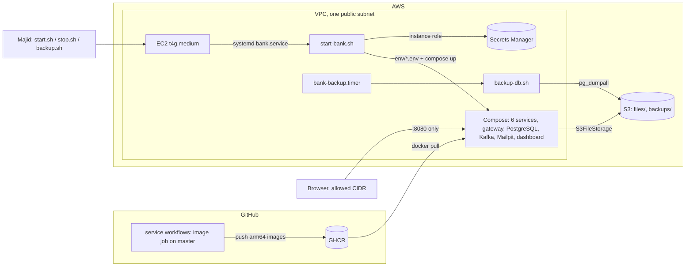

# Slices 8.2 to 8.5: AWS, Compose, CDK, S3 and CI images

## Part 1. The big picture

Locally, Aspire starts the bank. For a demo that others can open, the same bank must run in the cloud: cheaply, safely, and from code rather than console clicks. The design plan (section 9) chooses one small EC2 instance running Docker Compose, started only for demos.

Five pieces make that possible:

- **a Compose file** that runs the same images;
- **infrastructure as code** (CDK) that creates the network, the instance, the bucket, the secret and the permissions;
- **an S3 adapter** for uploaded files, because the instance's disk is not where customer documents belong;
- **scripts** to start, stop and back up;
- **CI jobs** that build the images.

What makes it hard:

- **Secrets.** The passwords must reach the containers without ever being in the repository, the template or the compose file.
- **Cost.** Every resource is paid by the hour or the month. A NAT gateway or a load balancer alone would cost more than the instance.
- **Nothing may happen without you.** Claude writes and checks the code, but every `cdk deploy`, `aws` command and image push is yours.

## Part 2. The building blocks and how they connect



### Compose for AWS (`bank-platform/deploy/docker-compose.aws.yml`)

- It runs the six services and the gateway from `ghcr.io/<owner>/bank-<service>`, with the same infrastructure images as the AppHost, plus the standalone Aspire dashboard (OTLP on port 18889).
- **Only the gateway port is published.** The dashboard, Mailpit and Kafka UI listen on 127.0.0.1 and are reached through an SSH tunnel.
- **Service discovery without Aspire:** the gateway gets the same `services__<name>__http__0` keys that Aspire sets.
- **Secrets:** each container loads `env/<container>.env`, an optional file written on the instance. A service sees only its own connection string, and `docker compose config` is valid without the files.

### CDK app (`deploy/cdk/src/Bank.Deploy`)

- **`Program.cs`** reads the `bank:*` context from `cdk.json`: the region, the allowed CIDR, an optional key pair and the image tag. The stack names a region but no account, so `cdk synth` runs with no AWS account at all.
- **`BankStack.cs`** builds the resources:
  - **Network:** a VPC with one public subnet and no NAT gateway, and a security group that opens the gateway port and SSH to one CIDR. The default is a documentation address, so nothing is open until you set yours.
  - **Instance:** a t4g.medium on Amazon Linux 2023 ARM, with 30 GB of encrypted gp3, IMDSv2 only and a hop limit of 2, so the containers can use the instance role.
  - **Storage:** an S3 bucket that blocks public access, enforces SSL, is kept on `cdk destroy`, and deletes backups after 30 days.
  - **Secrets and permissions:** a Secrets Manager secret with a random placeholder, and an instance role that can use that bucket, that secret and Session Manager.
  - **Startup:** three CDK assets (the compose file, the database init scripts and `deploy/instance/`), and user data that installs Docker and Compose, fetches the assets, writes `stack.env` (no secrets) and enables the systemd units.
  - **Outputs:** the instance id, public DNS, bucket and secret name.

### On the instance (`deploy/instance/`)

- **`start-bank.sh`** runs at every boot (`bank.service`). It reads the secret, writes the env files with mode 600, logs in to GHCR if a token is present, then runs `compose pull` and `compose up --wait`.
- **`backup-db.sh`** runs `pg_dumpall` piped into gzip, then copies the dump to `s3://<bucket>/backups/`. `bank-backup.timer` runs it nightly at 02:00 UTC, or soon after the next start if the instance was off.

### Your scripts (`deploy/start.sh`, `stop.sh`, `backup.sh`)

- `start.sh` starts the instance, waits for it, and prints the gateway URL and the SSH tunnel command.
- `stop.sh` stops the instance.
- `backup.sh` runs a backup now through SSM Run Command.

### S3 storage (`bank-customers/src/Bank.Customers.Api/Files/S3FileStorage.cs`)

- `S3FileStorage` implements `IFileStorage` with `PutObject`, `GetObject`, `GetObjectMetadata` and `DeleteObject`, under the `files/` prefix. A path with an empty, `.` or `..` part is refused, so a key can never leave the prefix (for example to reach `backups/`).
- `Program.cs` picks the implementation by `Files:Provider`. An unknown provider, or S3 without a bucket, fails at startup with the key's name.
- `S3FileStorageTests` run it against LocalStack in a container.

### CI (`.github/workflows/`)

- Each service workflow and the gateway workflow got an **`image` job**. On a push to `master`, after the tests pass, and only when the repository variable `PUBLISH_IMAGES` is `true`, it builds a linux-arm64 image with `dotnet publish /t:PublishContainer` and pushes it to GHCR.
- **`bank-e2e.yml`** runs the end-to-end scenarios on demand and keeps the service logs when a scenario fails.

## Part 3. Why it is designed this way

### D1 decisions on your delegation (please review)

- **bank-platform ADR 0002:** a t4g.medium, started and stopped by hand, no Elastic IP. The rejected alternative was a nightly stop schedule.
- **bank-platform ADR 0003:** service tests on every push, end-to-end on demand, images on `master` behind a variable. The rejected alternative was end-to-end on every push to `master`.
- **bank-platform ADR 0004:** the instance reads Secrets Manager into one env file per container. The rejected alternatives were a configuration provider in each service, and one secret per service.

### D2 (my choices)

| Choice | Why | Rejected |
| --- | --- | --- |
| No NAT gateway, public subnet only | A NAT gateway costs about $35 a month, more than the instance | Private subnet behind NAT |
| SSH and gateway from one CIDR, with a documentation default | Identity is simulated (stage 7), so the bank must not be open to the internet | Gateway open to 0.0.0.0/0 |
| Session Manager in the role | Backups and shell access without SSH keys | SSH only |
| CDK assets instead of cloning the repo on the instance | The instance needs no GitHub access, and the deployed files are exactly the reviewed ones | `git clone` in user data |
| Images from the SDK, not Dockerfiles | One less file per service; same base images Microsoft maintains | Dockerfiles |
| LocalStack 4.9 for the S3 test | MinIO images can no longer be pulled; 4.9 runs without an account token | No integration test |

### How the design changed

- **Secrets in the compose file:** the first version interpolated `${OPERATIONS_DB_PASSWORD}` and so on. Then `docker compose config` (the done-when check) fails without the secrets, and every service could read every password. The per-container env files fix both.
- **The banking review found five more things, all fixed:**
  - `start-bank.sh` wrote empty passwords when a key was missing: `exit` inside `$(...)` ends only the subshell, and `set -e` does not see a failure inside an `echo` argument. Since the database creates its roles once, an empty password would have been permanent. All keys are now checked first, non-empty, letters and digits, at least 24 characters, before anything is written;
  - the hop limit of 2 let **every** container reach the instance role, including the gateway and third-party images. Now only Customers (fixed address 172.30.0.10) passes the `DOCKER-USER` rule, and the role can only use `files/*`, put to `backups/*`, and read the secret;
  - an unpinned AMI would replace the instance (and its data) on a later deploy. The AMI is now pinned with `bank:amiId`, and the root volume is kept on termination;
  - the README told you to write your own IP into the tracked `cdk.json`. Your IP and the AMI are now passed with `-c` on the command line;
  - Kafka's data was not on its volume: confluent-local writes to `/tmp/kraft-combined-logs` unless `KAFKA_LOG_DIRS` says otherwise. It is set now, in both compose files.
- **IMDS:** a separate launch template for the hop limit clashed with the instance's own IMDSv2 setting. The instance now sets `HttpTokens` and `HttpPutResponseHopLimit` itself.

Patterns: infrastructure as code, immutable images from CI, twelve-factor configuration (environment only), least privilege, cost-driven design, secrets injected at runtime.

## 4. What was tested

```
cd core_banking/bank-platform/deploy/cdk && npx aws-cdk@2.1145.0 synth     # no AWS credentials
  → BankDemo.template.json: VPC, subnet, IGW, SG, t4g.medium (HttpTokens required, hop limit 2), S3, secret, role
docker compose -f core_banking/bank-platform/deploy/docker-compose.aws.yml config   → valid
cd core_banking/bank-customers && dotnet test   → UnitTests 34, IntegrationTests 29 (5 new S3 tests on LocalStack)
```

Not tested: the images on arm64, the user data on a real instance, and the scripts against AWS. Those run for the first time when you deploy.

## 5. What to watch later

- A compromised Customers container can still read the whole secret through the role (ADR 0004, accepted for the demo).
- User data runs once; changed deploy files must be copied to the instance by hand (README).
- Check two versions before the first deployment: the Compose plugin (`v2.29.7` in the user data) and the dashboard image tag (`aspire-dashboard:13.6`).
- `cdk.json` must get your CIDR before `cdk deploy`.
- The estimated cost is in `deploy/README.md`. The listings disagree for eu-north-1, so confirm in the AWS Pricing Calculator.

## 6. Check your understanding

1. Why does the instance role need a hop limit of 2 for the customers container to reach S3?
2. What would break, and what would leak, if all passwords were in one `.env` file shared by every container?
3. Which resources keep costing money while the instance is stopped?
