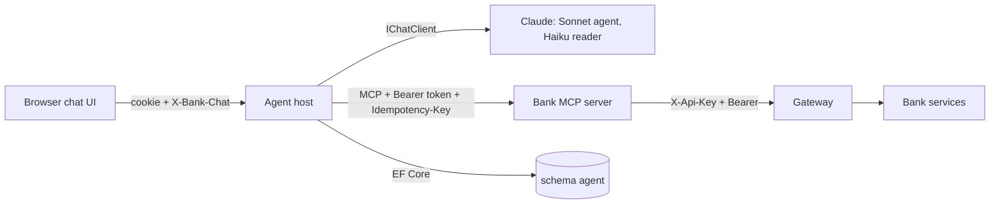

# Phase 2 agent: senior code review

- Round 1: 2026-11-03, branch `p2-stage-6-languages-eval` at `4783e8a` (findings F1 to F15).
- Round 2: 2026-11-04, same branch at `68a240f` ("fix(agent): one writer per chat, fail-safe safety lists, retryable unknown outcome, cost limits", agent ADR 0007). This document is the round 2 version. Section 3 says what happened to each round 1 finding; sections 4 and 5 hold the new findings (R1 to R7).

## 1. The big picture

Phase 2 puts an AI agent with a chat UI in front of the bank. Three parts do the work:

- **The agent host** (`agent/src/Bank.Agent.Host`) is a backend for frontend. It logs the person in, keeps the bank token in memory, stores chats in schema `agent`, runs the model and streams the answer over AG-UI.
- **The bank MCP server** (`agent/src/Bank.Agent.Mcp`) turns bank endpoints into tools, with one path per role (`/mcp/customer`, `/mcp/admin`).
- **The chat UI** (`agent/chat-ui`) uses React and assistant-ui. It renders the agent's tool calls as tables, cards, charts, diagrams, forms and confirmation cards.



The review asks one question: is this the simplest code that solves the problem correctly and safely?

Round 2 read every file that `68a240f` changed: `AgUiEndpoint`, `RunLimiter`, `ActionEndpoints`, `HostSessions`, `SessionSweeper`, `SessionGuard` and the split auth files, `ChatStore`, `ChatEndpoints`, `ChatHistory`, `MarkUntrusted`, `BankTools`, `LanguageModel`, `ToolResult`, `AgentTools`, `DocumentReader`, the MCP tool names and `ToolSets`, the evaluation `Runner`, the UI files `interactive.tsx`, `ChatView.tsx` and `api.ts`, and agent ADR 0007. It also followed one promise into the bank: which services honour `Idempotency-Key`.

Round 2 did not read line by line: the unchanged files from round 1, the test bodies (only their results), `i18n.ts` beyond the texts named below, and the bank services' business logic.

### Evidence

Every test suite of the agent passes at `68a240f`:

```
dotnet test tests/Bank.Agent.UnitTests          → Passed: 82, Failed: 0
dotnet test tests/Bank.Agent.Mcp.Tests          → Passed: 39, Failed: 0
dotnet test tests/Bank.Agent.IntegrationTests   → Passed: 52, Failed: 0   (Testcontainers PostgreSQL)
(cd chat-ui && npx vitest run)                  → Tests 35 passed (35)
```

Which bank services read `Idempotency-Key` (`grep -rn -i idempotency` in each service's `src`):

```
bank-accounts   → TransferEndpoints, StandingOrderEndpoints, CashMovements (IdempotentCommand)
bank-cards      → CardPayments
bank-lending    → (none)
bank-customers  → (none)
bank-operations → (none)
```

### Executive summary

The fix commit is good work. All 15 round 1 findings are fixed, and the fixes are simple: one in-memory lock, safe defaults instead of name lists, one shared history conversion, and limits in configuration. The code is now easier to read than in round 1, and the decisions are written down in ADR 0007.

The three most important problems now:

1. **The retry after "unknown" promises more than the bank gives** (R1, High). For most change tools the bank ignores `Idempotency-Key`. A second press can create a second loan application, a second note or a second upload, while the screen says "the bank makes it only once".
2. **Cancel after "unknown" says "Nothing was changed"** (R2, Medium). The change may already have happened, and the agent is told that it was cancelled.
3. **The run limit is per user only** (R3, Medium). The login screen shows the pattern of the public test logins (`IMP-C001`, "and any other customer the same way"), so about 100 logins are easy to use and the real ceiling is about 500 runs a minute on one API key, with no daily budget.

**Simplicity score: 8 / 10** (round 1: 7). `Events` is now three named steps, the auth types live in their own files, and the retry loop and the database race are gone. Points are lost for a repeated "cast the denied result" pattern and for `AgentParts`, which now carries six things.

## 2. Strengths

Everything from round 1 still holds: the token never reaches the model or the browser, `ConfirmFirst` plus the MCP server's key check enforce confirmations in code, there is one MCP path per role while the bank stays the security boundary, the document reader is quarantined, and logging records names and outcomes only.

New in round 2:

- **One writer per chat in one line** (`HostSession.ChatLock`, `Features/Auth/HostSessions.cs:289-295`). A run tries the lock without waiting and refuses with `run_in_progress` (`Features/AgUi/AgUiEndpoint.cs:98-102`). An action waits, because its effect already happened at the bank (`Features/AgUi/ActionEndpoints.cs:194-205`). The lock is released in a `finally`, also when the browser goes away.
- **Fail-safe defaults.** Every read is untrusted unless it is on the short bank-only list (`Features/Agent/MarkUntrusted.cs:17-23`). Host-only tools are recognised by a prefix that the MCP server owns, checked by a test (`Bank.Agent.Mcp/ToolSets.cs`, `Features/Agent/BankTools.cs:65-71, 98`).
- **History keeps the markers** (`Logic/ChatHistory.cs`). It is pure, unit-tested, and shared with the evaluation, so the evaluation now tests what runs.
- **Readable streaming.** `TurnAsync`, `BuildAgent` and `UntilFailure` each do one thing (`AgUiEndpoint.cs:129-264`), and the comment explains why `UntilFailure` exists (no `yield` in a `catch`).
- **Cost is a configuration choice**, recorded with Majid's decision: Sonnet for the agent, Haiku for the reader, 2000 output tokens, 20 messages of history, 5 runs per minute, and token counts logged per run (`Features/Agent/LanguageModel.cs:11-32`, `AgUiEndpoint.cs:201-203`).
- **The sweeper closes first and forgets after** (`Features/Auth/SessionSweeper.cs:40-45`), so its comment is now true.
- **ADR 0007** follows the workspace structure and names the price of each choice, for example "the lock is per process".

## 3. Round 1 findings: status

| ID | Round 1 finding | Status at `68a240f` | Where |
| --- | --- | --- | --- |
| F1 | Two runs on one chat | Fixed: `ChatLock`; a second run gets `run_in_progress`; integration test added | `AgUiEndpoint.cs:96-117` |
| F2 | Untrusted text loses markers in history | Fixed: components and actions are replayed between markers | `Logic/ChatHistory.cs:365-370` |
| F3 | Safety name lists fail open | Fixed: `BankOnlyReads` exceptions; `host_` prefix owned by the server | `MarkUntrusted.cs:17-23`, `BankTools.cs:65-98` |
| F4 | Timed-out change cannot be retried | Fixed in the host, but see **R1**: the bank does not always keep the promise | `ActionEndpoints.cs:59-66, 215-229` |
| F5 | No cost limits | Fixed: cheap profile, history cap, `RunLimiter`, token log; see **R3** for the remaining gap | `LanguageModel.cs`, `RunLimiter.cs` |
| F6 | Evaluation history differs from the chat | Fixed: `Runner` stores and replays through `ChatHistory` | `eval/Bank.Agent.Eval/Runner.cs` |
| F7 | `Events` is 110 lines | Fixed: `Events`, `TurnAsync`, `BuildAgent`, `UntilFailure` | `AgUiEndpoint.cs:88-264` |
| F8 | Shared helpers in feature files | Fixed: `Features/Agent/ToolResult.cs`, `Features/HostJson.cs` | |
| F9 | Idle sweep written twice | Fixed: `IdleLocked` | `HostSessions.cs` |
| F10 | Tuple of three nullables | Fixed: `Opened.Ok` / `Opened.Denied` | `ActionEndpoints.cs:165-187` |
| F11 | One file with six types | Fixed: `SessionGuard.cs`, `SessionCookie.cs`, `ChatClientHeader.cs`, `Problems.cs` | |
| F12 | Every denial became `missing_session` | Fixed: the guard's own problem is returned | `ChatEndpoints.cs:29-35, 41-46` |
| F13 | Failed sweep not retried | Fixed: close first, forget after | `SessionSweeper.cs:40-45` |
| F14 | Staging ran the echo silently | Fixed: the key is required outside Development and Testing | `LanguageModel.cs:56-64` |
| F15 | Actions loaded every message | Fixed: `FindHeaderAsync` | `ChatStore.cs`, `ActionEndpoints.cs:181` |

## 4. New findings

| ID | File:line | Category | Severity | Summary |
| --- | --- | --- | --- | --- |
| R1 | `Features/AgUi/ActionEndpoints.cs:61-66, 151-155, 225-228` | Correctness / idempotency | High | "Press again, the bank makes it once" is true only for Accounts and Cards tools |
| R2 | `chat-ui/src/interactive.tsx:136-148`, `ActionEndpoints.cs:73-88` | Correctness / UX | Medium | Cancel after "unknown" records "cancelled, nothing changed" |
| R3 | `Features/AgUi/RunLimiter.cs:315-330`, `AgUiEndpoint.cs:69` | Agent cost | Medium | Limit per user only; ~100 public logins give ~500 runs a minute and no daily budget |
| R4 | `AgUiEndpoint.cs:140, 189, 196` | Error handling | Low | A database error during a run breaks the stream without `RUN_ERROR` |
| R5 | `AgUiEndpoint.cs:69, 98` | Correctness | Low | A run refused with `run_in_progress` still uses a permit of the rate limit |
| R6 | `ActionEndpoints.cs:221, 225-228` | Correctness | Low | A host bug ("no such tool") is reported as "unknown" and offered for retry forever |
| R7 | `ActionEndpoints.cs:177, 187`, `ChatEndpoints.cs:33, 45` | Simplicity | Low | The "not allowed, so cast to denied" pattern is repeated four times |

## 5. Finding details

### R1. The retry promise holds only where the bank reads the key (High)

**Problem.** On a transport failure, `RunAsync` returns `unknown` and the host puts the pending item back, so the person can press Confirm again with the same `Idempotency-Key`. The text says: "Press the button again: the bank makes the change only once" (`ActionEndpoints.cs:227`, and `bankNoAnswer` in `i18n.ts:65`). But only Accounts (transfers, standing orders) and Cards (card payments) read that header. Lending, Customers and Operations ignore it (see the grep in section 1).

What a second press does when the first one did reach the bank:

| Tool | Second press |
| --- | --- |
| `transfer_create`, `standing_order_create`, `card_payment` | Same key, made once: correct |
| `loan_application_approve`, `_reject`, `_start_review`, `_disburse`, `business_day_close`, `currency_activate`, `payoff_request`, `information_request_complete` | Refused by the state check, so it shows "failed", although the first press worked: safe, but misleading |
| `loan_application_submit`, `customer_note_add`, `host_document_upload`, `loan_application_request_information` | **Made twice**: a second application, note, file or request |
| `appointment_book`, `appointment_book_for_customer` | Depends on the slot check (not read in this review) |

**Why it matters.** The fix moved the risk instead of removing it. Before, a double change needed the person to ask the agent again. Now the UI invites a second press and promises it is safe.

**Before** (`ActionEndpoints.cs:61-66`):

```csharp
if (outcome.Status == Unknown)
{
    // The bank may have made the change. Keep it, so Confirm can be pressed again with the same idempotency key:
    // the bank then makes it at most once.
    session.Pending[change.Id] = change;
}
```

**After.** Let the MCP server say which tools are safe to repeat. MCP has an annotation for exactly this (`idempotentHint`, `[McpServerTool(Idempotent = true)]`). The default stays safe: a tool without the annotation is not offered for a retry.

```csharp
// Bank.Agent.Mcp: only where the bank endpoint reads Idempotency-Key (Accounts, Cards)
[McpServerTool(Name = "transfer_create", ReadOnly = false, Destructive = false, Idempotent = true)]

// BankToolSet: remember the hint next to the tool
public bool CanRetry(string name) =>
    Find(name)?.ProtocolTool.Annotations?.IdempotentHint == true;   // McpClientTool; FakeBank sets it in tests

// ActionEndpoints.ConfirmAsync
if (outcome.Status == Unknown && retryable)
{
    session.Pending[change.Id] = change;   // same key, the bank makes it once
}
// otherwise: final "unknown" with "Check the result before asking again" (as round 1's text said)
```

`RunAsync` returns whether the tool was retryable along with the outcome, so the endpoint needs no second MCP connection. Add a test in `Bank.Agent.Mcp.Tests` that only the Accounts and Cards change tools carry `Idempotent = true`, and an integration test for a non-retryable "unknown".

The real fix is in the bank: support `Idempotency-Key` in Lending, Customers and Operations, as Accounts already does (`IdempotentCommand`). That changes phase 1, which is open only for bug fixes, so it is Majid's call (open question 1). The annotation is still needed until then, and it keeps the host honest afterwards.

**Effect.** The UI promises "once" only where the bank keeps that promise. Everywhere else the person is told to check before trying again.

### R2. Cancel after "unknown" says nothing changed (Medium)

**Problem.** In the `unknown` state the card shows both buttons again (`interactive.tsx:136`). Cancel takes the pending item, stores `status = "cancelled"` (`ActionEndpoints.cs:86`), shows "Cancelled. Nothing was changed." (`interactive.tsx:148`), and tells the agent "I cancelled". But the first press may have made the change.

**After.** After `unknown`, show only Confirm (or "Try again"), and a short line that the person can check the result with the agent. If Cancel must stay, record it as `abandoned` with the text "Not sent again. The first attempt may have been made; check before trying again", not as `cancelled`.

```tsx
{!readOnly && state === "open" && (/* Confirm + Cancel */)}
{!readOnly && state === "unknown" && (
  <div className="actions">
    <button type="button" onClick={() => void answer("confirm")}>{t("tryAgain")}</button>
  </div>
)}
```

Together with R1: for a non-retryable tool there is no button at all after `unknown`, only the "check first" text.

**Effect.** The chat history and the agent never say "nothing was changed" when nobody knows.

### R3. The run limit is per user only (Medium)

**Problem.** `RunLimiter` allows 5 runs per user and minute (`RunLimiter.cs:317-323`). The ADR names one consequence (the shared admin login shares its limit). The bigger one is the other way round: the login screen shows `IMP-C001` and says any other customer logs in the same way (`chat-ui/src/LoginForm.tsx:68-77`, workspace ADR 0007), so one person can use about 100 logins. That gives about 500 runs a minute, and each run can make several model calls (tools, document reads). Nothing caps the whole host per hour or per day.

**After.** Add one global partition to the same limiter. It costs a few lines and needs no new type:

```csharp
// RunLimiter: one window per user and one for the whole host
private readonly PartitionedRateLimiter<string> perUser = ...;              // as today
private readonly RateLimiter global = new FixedWindowRateLimiter(new()
{
    PermitLimit = options.RunsPerHour,   // Agent:Model:RunsPerHour, such as 200
    Window = TimeSpan.FromHours(1),
    QueueLimit = 0,
});

public bool TryStart(string username)
{
    using var user = perUser.AttemptAcquire(username);
    if (!user.IsAcquired) return false;
    using var all = global.AttemptAcquire();
    return all.IsAcquired;
}
```

Also set a monthly spend limit on the API key in the Anthropic console. That is the boundary that holds even if the host has a bug, so it belongs in `home-hosting.md`.

**Effect.** The cost has a known ceiling per hour, not only per person.

### R4. A database error breaks the stream without `RUN_ERROR` (Low)

**Problem.** `TurnAsync` writes to the database three times: the person's message (`AgUiEndpoint.cs:140`), each component (`:189`) and the final text (`:196`). If one of them throws (the database restarts, or the unique index catches a bug), the exception leaves the SSE iterator. The browser sees a broken stream instead of a `RUN_ERROR`, and `Events` never sends `RUN_FINISHED`. The lock is still released (`finally`), so nothing hangs.

**After.** Let `Events` turn any exception from `TurnAsync` into one `RUN_ERROR` `chat_unavailable`, the same way `UntilFailure` does for the model. `UntilFailure` can become generic (`UntilFailure<T>`) and wrap `TurnAsync` too, so the code gains no new idea.

### R5. A refused run still uses a permit (Low)

**Problem.** The rate limit is taken in `RunAsync` (`AgUiEndpoint.cs:69`), before the lock is tried in `Events` (`:98`). A second tab that gets `run_in_progress` has still used one of the person's five permits.

**After.** Take the lock first and the permit second, or accept it and say so in ADR 0007's consequences. This only matters if a person often uses two tabs.

### R6. A host bug becomes a retryable "unknown" (Low)

**Problem.** `bank.Find(tool) ?? throw new InvalidOperationException(...)` (`ActionEndpoints.cs:221`) is caught by the same `catch` as a timeout (`:225`) and becomes `unknown`. The card then asks the person to press again, which fails the same way every time.

**After.** Treat only transport failures as `unknown` (`HttpRequestException`, `TaskCanceledException` from a timeout, `IOException`). Everything else is `failed`, logged as a host error:

```csharp
catch (Exception ex) when (!ct.IsCancellationRequested && ex is HttpRequestException or TaskCanceledException or IOException)
{
    return new Outcome(Unknown, ...);
}
```

### R7. A repeated "cast the denied result" pattern (Low)

**Problem.** Four places write `if (x is not Allowed(var s)) return ((Denied)x).Problem;` (`ActionEndpoints.cs:177, 187`, `ChatEndpoints.cs:33, 45`). The cast is safe today, but a third result type would turn it into an exception at run time.

**After.** Use one switch that the compiler can check, or a small helper on `GuardResult`:

```csharp
// GuardResult
public IResult? Problem => this is Denied d ? d.Problem : null;

// caller
var guarded = await guard.CheckAsync(http, ct);
if (guarded.Problem is { } problem) return problem;
var session = ((GuardResult.Allowed)guarded).Session;
```

Or, simplest: `if (guarded is GuardResult.Denied(var problem, _)) return problem;`, which `MeAsync` already does.

## 6. Simplification reminders, by priority

1. Make "can this be retried" a property of the tool (R1), not a promise of the host. It replaces a wrong sentence with one annotation.
2. Show one button after "unknown" (R2). It removes a state from the card instead of adding one.
3. Use one failure path for the stream (R4) by making `UntilFailure` generic.
4. Use one pattern for a denied guard (R7).

Keep, even though it adds code: `ChatLock` and its `finally`, the `host_` prefix with its test, the wrapping of every replayed component, and `ReaderModel` as its own type. Each one is small and closes a real gap.

## 7. Roadmap

**Quick wins (under an hour each):** R2, R5 (or a line in ADR 0007), R6, R7, and a spend limit on the API key.

**Short term (one slice):** R1 in the agent (annotation, retry only when it is safe, tests), R3 (global window), R4.

**Long term:** support `Idempotency-Key` in Lending, Customers and Operations (phase 1 change, Majid's decision). Run the evaluation set on the cheap profile before the agent goes live (ADR 0007 already says so). Write a retention decision for chats ("kept forever" today).

## 8. Open questions

1. Is a missing `Idempotency-Key` in Lending, Customers and Operations a phase 1 bug (so it can be fixed now), or a phase 2 need (so the agent works around it with R1)?
2. Does the appointment booking refuse a second booking of the same slot? This decides whether `appointment_book` may be marked retryable.
3. What hourly or daily ceiling is acceptable for the demo's API key (R3)?
4. Has the evaluation set been run on Sonnet and Haiku yet, and with which results?
5. Should the admin's reads of other customers' chats also be shown to the admin as an audit list, or is the log line enough?
